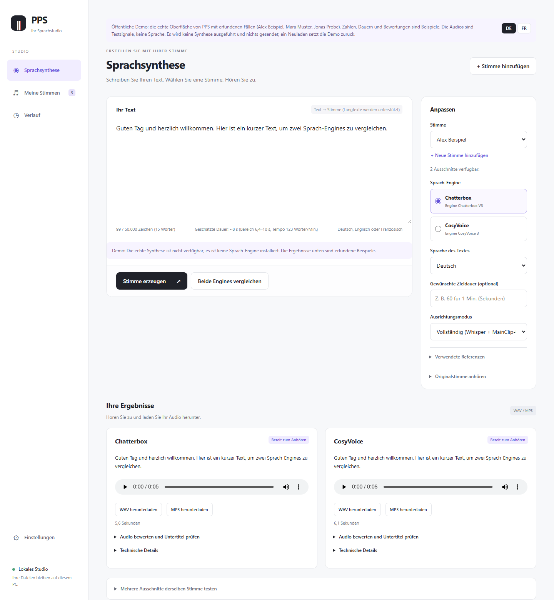

# PPS – lokales Sprachstudio

Ein unabhängiger Dienst verwaltet Referenzstimmen, Syntheseaufträge, Ressourcen, Wortausrichtung und Qualitätsprüfung. Die Sprachmodelle werden integriert; sie wurden nicht in diesem Projekt trainiert.

**Technik:** Python, FastAPI, SQLite, Chatterbox, CosyVoice.

[Interaktive Demo](https://jorxas.github.io/PPS/) · [Portfolio](https://jorxas.github.io/Portfolio/) · [Architektur](ARCHITEKTUR.md) · [Prüfstatus](PRUEFUNG.md)

## Ausprobieren

Die öffentliche Demo führt die echte Weboberfläche des Dienstes aus (`pps/web.html`, `pps/static/*`), unverändert. Nur der lokale Dienst fehlt: `demo/demo-start.js` beantwortet die Anfragen an `/v1/*` mit erfundenen Fällen (drei Stimmen, ein Vergleich, fünf Aufträge, eine Stimmenvorbereitung). Die Audios sind kurze synthetische Testsignale, keine Sprache. Eine echte Synthese, ein Dateiimport und die Dokumentationsseite sind dort nicht verfügbar und als solche gekennzeichnet; es werden keine Modelle, Konten oder Anbieter angesprochen. Die Oberfläche ist zweisprachig: Deutsch ist die Voreinstellung, Französisch (die ursprüngliche Sprache der Oberfläche) lässt sich über den Schalter DE | FR im Demo-Hinweis oder mit `?lang=fr` wählen. Alle Texte stehen in `pps/static/i18n.js`, die erfundenen Fälle und Meldungen in beiden Sprachen in `demo/demo-start.js`.

## Demo bauen und prüfen

~~~sh
node tools/demo-bauen.mjs
cd tools/frontend && npm ci && cd ../..
node tools/demo-pruefen.cjs
python -m http.server 8080 --bind 127.0.0.1 --directory dist
~~~

`dist/` danach unter http://127.0.0.1:8080 öffnen. Das Bauen benötigt nur Node.js; die Browserprüfung zusätzlich einen installierten Chrome oder Edge (`BROWSER_PFAD`).

## Lokal prüfen

~~~sh
python -m pip install -r requirements/api.txt
python -m pytest -q
~~~

Die genauen geprüften Befehle und Grenzen stehen in [PRUEFUNG.md](PRUEFUNG.md). Produktive Schlüssel, persönliche Daten und Modelle gehören ausschließlich in die lokale Installation.

## Herkunft

Dies ist eine für die Veröffentlichung geprüfte Ableitung eines bestehenden lokalen Projekts. [HERKUNFT.md](HERKUNFT.md) trennt den ursprünglichen Entwicklungsstand von den jetzt ausgeführten Veröffentlichungsarbeiten. Die ursprüngliche Oberfläche war französisch; sie ist jetzt zweisprachig (Deutsch Standard, Französisch wählbar). Technische Bezeichner und die Fehlermeldungen des Python-Dienstes sind teilweise französisch oder englisch. Neue Präsentation und Dokumentation sind deutsch.

## Rechte und Abhängigkeiten

Für eigenen Quellcode wird hier keine zusätzliche Nutzungslizenz eingeräumt. Die Lizenzen der genannten Bibliotheken und Modelle gelten unabhängig davon. Fremde Modelle, Stimmen, Medien und Zugangsdaten werden nicht mitgeliefert. Siehe [DRITTANBIETER.md](DRITTANBIETER.md).

## Lokale Werkzeuge und Modelle

FFprobe wird über `PPS_FFPROBE`, den Suchpfad oder `tools/media/ffprobe.exe` gefunden. Modellquellen und Interpreter stehen in `config.toml`; an die eigene Installation anpassen. Modellgewichte und die optionalen Analysemodelle (VAD/YAMNet) werden nicht mitgeliefert. Die zugehörigen CPU-Integrationstests werden ohne diese Modelle ausdrücklich übersprungen. Für den API-Dienst: `python -m pps`. Die Oberfläche ist ohne installierte Modelle sichtbar; eine echte Synthese ist dann nicht verfügbar.

## Modellinstallation

`requirements/api.txt` beschreibt den schlanken API-Dienst. Die getrennten Modellumgebungen und Quellpakete werden zusätzlich benötigt; `scripts/setup_engines.py` dokumentiert die lokalen Installationsschritte. Vor Ausführung die Pfade und Lizenzbedingungen prüfen. Der Dienst lädt während einer API-Anfrage keine Modelle aus dem Internet nach. Die für Medienanalyse optional benötigten VAD/YAMNet-Ressourcen sind externe Modelle und separat zu installieren.
